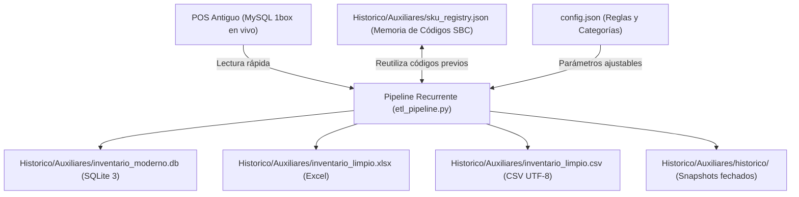

# Sincronización y Saneamiento Continuo de Inventario (POS Moderno)

Este directorio contiene el entorno aislado de extracción, limpieza y transformación continua (**ETL**) del inventario. Permite mantener un catálogo saneado, moderno y listo para el nuevo sistema POS, mientras la tienda sigue operando en el antiguo sistema sobre XAMPP (`1box`).

> **Caja (POS):** el punto de venta ya es **autónomo**: su inventario vive en
> `pos.db` (7,001 productos importados del catálogo limpio), con ventas,
> devoluciones, movimientos de existencias auditados, usuarios y roles.
> Abre `caja.bat` y consulta **`README_POS.md`** para el flujo de cobro,
> inventario, cortes, respaldos y límites. Este documento describe el ETL y el
> catálogo que alimentó la carga inicial (hoy en `Historico/Auxiliares/`).
>
> **Para la computadora nueva:** empieza por **`INSTALACION.md`**.
> **Para el cierre de inventario:** **`Historico/Auxiliares/CORTE_Y_MIGRACION.md`**.

---

## 🏗️ Flujo de Arquitectura



---

## ⚙️ Principios Clave del Proceso

### 1. Memoria Persistente de Códigos (`sku_registry.json`)
* El sistema **recuerda qué código SBC le asignó a cada producto** en ejecuciones anteriores.
* Al volver a ejecutar la sincronización, un producto sin código de barra conservará exactamente el mismo SKU asignado (ej. `SBC-00045`).
* Si se crean productos nuevos en el POS antiguo sin código, se les asigna automáticamente el siguiente número consecutivo disponible (`max + 1`).

### 2. Ventana de Ventas Dinámica
* La fecha de corte evalúa automáticamente los últimos **365 días móviles** (calculados a partir de la fecha y hora exacta en que se ejecuta).

### 3. Configuración y Mejoras sin Programar (`config.json`)
Puedes afinar y evolucionar las reglas de limpieza editando el archivo `config.json`:
* **`category_normalization`**: Mapeo para corregir o fusionar nombres de categorías duplicadas o mal escritas.
* **`inactivity_days`**: Número de días de inactividad permitidos para productos sin stock (por defecto: 365).
* **`item_whitelist`**: Lista de IDs de productos que se deben conservar siempre como activos (aunque no tengan ventas).
* **`item_blacklist`**: Lista de IDs de productos que se deben forzar a descartar/archivar.
* **`location_junk_values`**: Valores de ubicación que se consideran basura (por defecto `.`, `-`, `s/u`…). Se exportan vacíos.
* **`embed_alt_code_in_name`**: Si es `true`, agrega el primer código alternativo al final del nombre cuando cabe en `name_max_length` (por defecto `false`).
* **`name_max_length`**: Límite de caracteres para el nombre al incrustar códigos (por defecto `59`).

### 4. Respaldo Histórico Automático (`Historico/Auxiliares/historico/`)
* Cada ejecución genera automáticamente una copia congelada con fecha y hora en `Historico/Auxiliares/historico/inventario_AAAAMMDD_HHMMSS.xlsx`. Esto permite auditar la evolución de ventas y existencias a lo largo del tiempo.

### 5. Tolerancia a Archivos Abiertos
* Si el archivo principal `inventario_limpio.xlsx` se encuentra abierto en Microsoft Excel, el script detecta el bloqueo y guarda los cambios en una copia alternativa (`inventario_limpio_nuevo.xlsx`) sin interrumpir la ejecución.

### 6. Ubicación Física de los Productos (copia literal)
* La ubicación se lee de **`phppos_location_items.location`** (sucursal `location_id = 1`). No está en `phppos_items` y **no** es un campo personalizado.
* Se copia **texto idéntico al origen**: sin recortar espacios, sin cambiar mayúsculas y sin validar formato. Valores como `A01-006`, `1A` o `406` se conservan tal cual.
* Los **valores basura** definidos en `config.json` → `location_junk_values` (por ejemplo `.`, `-`, `s/u`) se descartan y quedan vacíos; no se inventa ni se reinterpreta el dato.
* En productos duplicados que se fusionan, manda la ubicación del producto maestro; si el maestro no tiene y todos los duplicados comparten un único valor, se hereda (y se contabiliza en el reporte).
* Si los duplicados tienen ubicaciones distintas, se conserva la del maestro y el conflicto se registra en `reporte_test_ubicaciones.md` para revisión manual.
* La columna se exporta como **`Ubicación`** en Excel/CSV y como `location` en SQLite.

### 7. Modo Prueba (`--test`)
* `python etl_pipeline.py --test` escribe todo en `C:\pos_moderno\test\` (`inventario_test.db`, `.csv`, `.xlsx`, `reporte_test.md`).
* En modo prueba **no** se modifica `sku_registry.json`, no se tocan los archivos de producción y no se generan snapshots en `Historico/Auxiliares/historico/`.
* Genera además `reporte_test_ubicaciones.md` con el conteo de ubicaciones, los conflictos de fusión y la **comparación carácter por carácter** contra `1box` (debe dar 0 diferencias).

---

## 🚀 Cómo Ejecutar la Sincronización

### Método 1: Un solo clic (Recomendado)
Haz doble clic sobre el archivo ejecutable:
```text
C:\pos_moderno\actualizar_inventario.bat
```
*(Puedes hacer clic derecho sobre él y seleccionar **Enviar a > Escritorio (crear acceso directo)**).*

### Método 2: Desde la Terminal
```powershell
cd C:\pos_moderno
python etl_pipeline.py
```
El proceso toma aproximadamente **9 segundos** en evaluar los más de 13,000 registros históricos y actualizar los archivos.

### Método 3: Modo Prueba (no toca producción)
```powershell
cd C:\pos_moderno
python etl_pipeline.py --test
```
Genera los resultados en la carpeta `test\` junto con `reporte_test_ubicaciones.md`.

---

## 🔎 Buscador de Productos (interfaz local)

Interfaz para el mostrador que funciona con cualquier **lector de código de barras USB en modo teclado** (escribe el código y envía Enter).

### Cómo iniciar
```text
C:\pos_moderno\buscar_productos.bat
```
Abre el navegador automáticamente en `http://127.0.0.1:8090/`. La ventana negra debe quedar abierta; al cerrarla se detiene el buscador.

### Qué hace
* **Escaneo directo:** al leer un código, muestra una ficha grande con nombre, **ubicación en tienda**, precio, stock y código.
* **Búsqueda por nombre:** escribe parte del nombre (sin importar acentos ni mayúsculas) y filtra al instante.
* **Búsqueda por SKU:** también reconoce los códigos internos (`SBC-`, `C6-`, etc.).
* **Identificadores adicionales:** encuentra el producto por el valor capturado en el campo **UPC/EAN/ISBN** de `1box` y por los *números de artículo adicionales*, aunque no sean el código de barras principal.
* **Sin ubicación:** los productos sin ubicación capturada se marcan en ámbar para poder corregirlos después.
* **Solo local:** escucha únicamente en `127.0.0.1`, no se publica en la red ni requiere internet.
* **Siempre actualizado:** el buscador y la caja usan el inventario del POS (`pos.db`). Sólo si ese inventario aún no se ha importado, relee el catálogo limpio cuando el ETL lo regenera.

### Atajos
| Tecla | Acción |
| :--- | :--- |
| Escanear + Enter | Busca el código exacto |
| Escribir | Búsqueda por nombre en vivo |
| **F2** | Enfoca el buscador |
| **Esc** | Limpia la búsqueda |

### Archivos
| Archivo | Descripción |
| :--- | :--- |
| **`app_pos.py`** | Servidor local (solo biblioteca estándar de Python). |
| **`ui/index.html`**, **`ui/estilos.css`**, **`ui/app.js`** | Interfaz del buscador. |
| **`buscar_productos.bat`** | Lanzador de doble clic. |

### Identificadores adicionales (UPC/EAN/ISBN)

En `1box`, el campo **UPC/EAN/ISBN** (`phppos_items.item_number`) y la tabla de **números de artículo adicionales** se usaron también para capturar códigos que no son el código de barras principal. El catálogo los conserva todos:

| Dónde | Qué guarda |
| :--- | :--- |
| `products.item_number` | Valor original del campo UPC/EAN/ISBN de `1box`. |
| `products.alt_codes` | Todos los demás identificadores (incluye los adicionales), separados por ` \| `. |
| Excel / CSV | Columnas **“UPC/EAN/ISBN (1box)”** y **“Códigos adicionales”** al final. |

El buscador indexa barcode, SKU, `item_number` y cada código alternativo: un escaneo o tecleo de cualquiera de ellos devuelve la ficha exacta.

**¿Agregar el código al nombre?** Es opcional y está **desactivado** por defecto, porque ensucia nombres, etiquetas y tickets. Si se necesita (por ejemplo, para otro sistema que solo busque por nombre), basta con editar `config.json`:

```json
"embed_alt_code_in_name": true,
"name_max_length": 59
```

Así el primer código alternativo se agrega al final del nombre **solo cuando el resultado no excede 59 caracteres** (incluyendo espacios).

---

## 📁 Estructura del Directorio

| Archivo / Carpeta | Descripción |
| :--- | :--- |
| **`actualizar_inventario.bat`** | Lanzador de un solo clic para sincronizar el inventario. |
| **`buscar_productos.bat`** | Lanzador del buscador local con lector de código de barras. |
| **`app_pos.py`** | Servidor local del buscador (interfaz web en `127.0.0.1`). |
| **`ui/`** | Interfaz del buscador: HTML, estilos y lógica de búsqueda. |
| **`etl_pipeline.py`** | Script principal en Python con la lógica de limpieza, deduplicación y exportación (bloqueado por el sello de congelamiento). |
| **`config.json`** | Archivo de reglas de negocio, umbral de días y normalización de categorías. |
| **`Historico/Auxiliares/sku_registry.json`** | Base de datos de mapeo ID Original $\leftrightarrow$ SKU `SBC-` persistente. |
| **`Historico/Auxiliares/inventario_moderno.db`** | Base de datos moderna y minimalista en **SQLite 3** (`products`, `categories`, `archived_products`). |
| **`Historico/Auxiliares/inventario_limpio.xlsx`** | Catálogo en Excel con formato profesional, márgenes calculados y hoja de métricas. |
| **`Historico/Auxiliares/inventario_limpio.csv`** | Archivo CSV estándar con BOM para importar a cualquier sistema POS moderno. |
| **`Historico/Auxiliares/reporte_migracion.md`** | Reporte técnico generado con las métricas de la última sincronización. |
| **`Historico/Auxiliares/historico/`** | Carpeta con respaldos fechados de cada exportación realizada. |
| **`test/`** | Resultados aislados del modo prueba (`--test`), incluido el reporte de ubicaciones. |

> **Nota (18/11/2026):** estos archivos son **legado de referencia**. El POS ya
> opera con `pos.db` y no los consulta en el día a día. El ETL quedó bloqueado
> por `Historico/Auxiliares/INVENTARIO_CONGELADO.txt`; sólo corre con
> `--descongelar` de forma deliberada.

